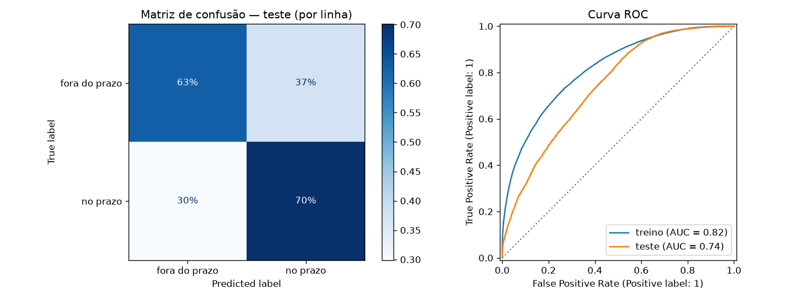
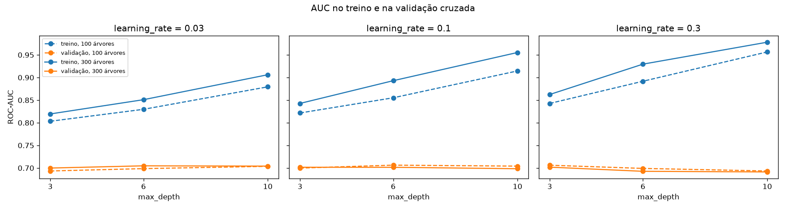
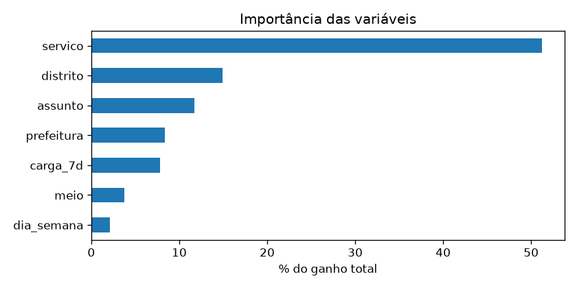
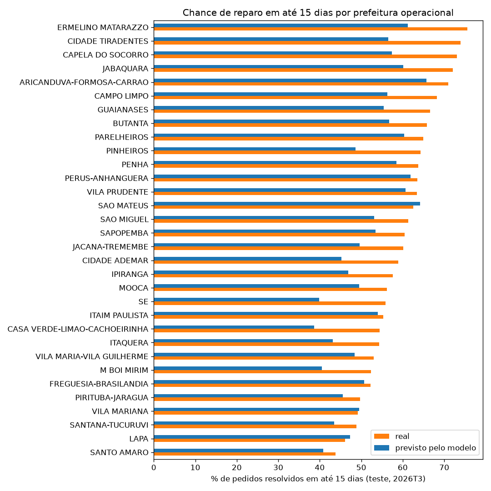

# Relatório de Machine Learning — Hakari

**Aluno:** Lucas Henzo Ide Yuki — RM 554865
**Notebook:** [`hakari_ml.ipynb`](hakari_ml.ipynb) · **Dados:** [`dados/README.md`](dados/README.md) · **Vídeo:** [youtu.be/G1ZjQpvnstI](https://youtu.be/G1ZjQpvnstI)

## 1. Problema

O Hakari é uma rede de nós ESP32 acoplados aos postes que detecta quando a lâmpada apaga e abre a
ocorrência sozinha. A pergunta por trás dele é quanto tempo o cidadão espera, no escuro, até alguém
consertar.

O SP156, canal oficial de pedidos da Prefeitura de São Paulo, não registra iluminação pública: nenhum
serviço da base menciona lâmpada, luminária ou iluminação. O que dá para medir com dados reais é a espera
nos outros reparos de infraestrutura do bairro, que seguem o mesmo caminho (o morador percebe, reclama e
espera).

**Pergunta de ML:** um pedido de reparo de infraestrutura feito ao SP156 vai ser resolvido em até 15 dias?

**Cidadão beneficiado:** o morador que reporta um buraco, um bueiro entupido, um poste em mau estado ou
mato alto e não sabe quando vai ser atendido.

## 2. Dados

**Fonte:** *Dados do SP156 - Solicitações*, Portal de Dados Abertos da Prefeitura de São Paulo
(https://dados.prefeitura.sp.gov.br/dataset/dados-do-sp156). Dados públicos e reais, sem dados pessoais.

**Período:** pedidos abertos de 01/10/2025 a 30/09/2026, quatro arquivos trimestrais.

**Recorte:** tema *Rua e bairro*, só os assuntos de reparo físico (asfalto, fiação e postes, drenagem,
capinação, praças, ruas e vielas), com **231.236 pedidos**. Fiscalizações como PSIU e ambulantes ficaram
de fora.

**Tratamento:** os arquivos do portal não têm formato único. Três usam `;`, Latin-1 e datas dia/mês, e
o mais recente usa `,`, UTF-8 e datas **mês/dia**. Lidos do mesmo jeito, as datas do último trimestre
sairiam trocadas sem erro algum. Logradouro, número, CEP e coordenadas foram descartados.

## 3. Preparação

**Rótulo com pedidos ainda abertos.** Na extração, até um terço dos pedidos de um trimestre ainda
estava aberto. Treinar só com os finalizados ensinaria o modelo com os casos mais rápidos. A regra:

| Situação na extração | Rótulo |
|---|---|
| Finalizado em até 15 dias | 1 |
| Finalizado depois de 15 dias | 0 |
| Aberto há mais de 15 dias | 0 (já passou do prazo) |
| Aberto há 15 dias ou menos, ou cancelado | fora |

Assim só 2% dos pedidos ficam de fora, e as classes ficam equilibradas (58% de "no prazo" no treino, 59%
no teste).

**Variáveis**, todas conhecidas no momento da abertura: assunto, serviço, canal, prefeitura operacional,
distrito, dia da semana e `carga_7d`, o número de pedidos da mesma região nos 7 dias anteriores.
Ficaram de fora a data de finalização e o status (vazamento), o órgão (reclassificado depois da
abertura) e o mês (o teste cobre meses que o treino não tem).

**Divisão temporal:** treino de 2025T4 a 2026T2 (169.816 pedidos), teste em 2026T3 (56.489 pedidos).
É o uso real do modelo: prever pedidos futuros a partir do passado.

## 4. Modelo

**XGBoost.** Os dados são tabulares, quase todos categóricos (28 serviços, 97 distritos) e com
interações (o mesmo serviço é rápido numa região e lento em outra). Árvores com boosting capturam isso,
tratam categorias de forma nativa e são o modelo de referência para esse tipo de dado.

**Busca:** 18 combinações de `max_depth` (3, 6, 10), `learning_rate` (0,03, 0,1, 0,3) e `n_estimators`
(100, 300), com validação cruzada só no treino.

**Validação temporal.** A validação também anda do passado para o futuro: treina em 2025T4 e valida em
2026T1; treina em 2025T4 + 2026T1 e valida em 2026T2. A validação aleatória de 5 partes também foi
testada e estimou AUC de 0,80 para a mesma configuração, bem acima dos 0,74 do teste: pedidos da mesma
semana e equipe caem dos dois lados e o modelo é premiado por reconhecer um período já visto. A temporal
estimou 0,71, perto do resultado real.

**Escolhido:** `max_depth=6`, `learning_rate=0.1`, `n_estimators=100`.

## 5. Resultados

| Métrica | Treino | Teste | Linha de base (teste) |
|---|---|---|---|
| ROC-AUC | 0,816 | **0,743** | 0,500 |
| Acurácia | 0,737 | **0,672** | 0,594 |
| Precisão | 0,751 | 0,734 | 0,594 |
| Recall | 0,812 | 0,701 | 1,000 |
| F1 | 0,780 | 0,717 | 0,745 |

A linha de base responde sempre "no prazo". O F1 dela é maior só por isso: nunca erra um pedido rápido,
mas não separa nada (AUC 0,50).

**Overfitting.** A AUC cai 0,07 do treino para o teste. O gráfico mostra a causa principal: com mais
profundidade, o treino sobe até 0,98 e a validação fica parada em torno de 0,70. A profundidade 6 com
100 árvores é o ponto em que a validação é máxima antes de o ganho virar só memorização. O restante da
queda é mudança no tempo: em 2026T3 a cidade resolveu mais rápido do que no treino, e o modelo
subestima o resultado real em quase todas as regiões.

O tipo de serviço explica metade do ganho do modelo, seguido do distrito e do assunto.

## 6. Conclusão para o cidadão

- **O endereço pesa.** Entre julho e setembro de 2026, um pedido de reparo em Ermelino Matarazzo teve
  76% de chance de sair em até 15 dias. Em Santo Amaro, 44%.
- **Postes e fiação são o pior caso da cidade.** Só 28% desses pedidos foram resolvidos em até 15 dias,
  contra 66% dos tapa-buracos e 79% das capinações.

**Para o Hakari.** A cidade não tem dado nenhum sobre lâmpada apagada, e o que existe sobre postes é a
categoria mais lenta. O Hakari ataca esse ponto: a ocorrência nasce no momento da falha, não quando
alguém decide reclamar, e a prefeitura passa a ter o dado que hoje não existe. Um modelo como este pode
então ordenar a fila da manutenção pelas regiões e serviços com maior risco de atraso.

**Limitações.** O SP156 registra pedidos, não problemas; os assuntos são reclassificados entre
relatórios (Fiação e postes passa de 738 para 13.332 pedidos entre o primeiro e o último trimestre); e
faltam variáveis de clima e de capacidade das equipes, que devem explicar boa parte do erro restante.
